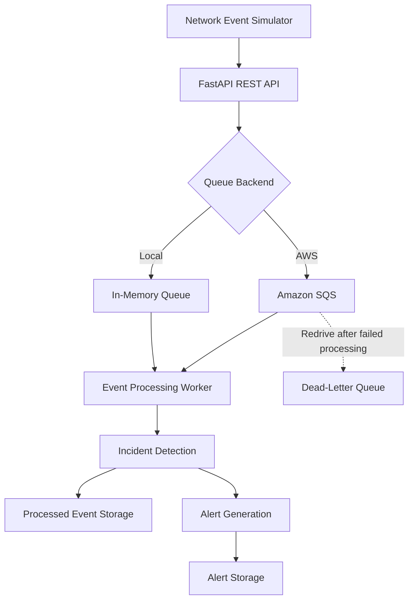

# MTN Network Monitoring & Customer Alert Platform

An educational, event-driven AWS cloud engineering project that simulates telecommunications network events, processes them asynchronously, detects incidents, and creates operational alerts.

> **Disclaimer:** This is an independent educational simulation. It does not use real MTN network telemetry and is not an official MTN system.

## 1. Business Problem

Telecommunications networks generate events such as dropped calls, service outages, high latency, failed transactions, and device failures.

These events need to be collected and processed reliably so that potential incidents can be identified and operations teams can respond appropriately.

This project demonstrates how cloud services can support an event-driven monitoring and incident detection workflow.

## 2. Project Objectives

The platform is designed to:

- Simulate telecommunications network events.
- Receive and validate events through a REST API.
- Queue events for asynchronous processing.
- Detect incidents based on event characteristics.
- Store processed event records and generated alerts.
- Use AWS infrastructure to support reliable event handling.
- Provision cloud resources using Terraform.

## 3. Architecture

The current implementation follows this workflow:



## 4. Technologies Used

| Technology | Purpose |
|---|---|
| Python | Application logic and event processing |
| FastAPI | REST API and event ingestion |
| Pydantic | Event validation |
| Amazon SQS | Asynchronous event queuing |
| Amazon SQS Dead-Letter Queue | Handling repeatedly unsuccessful messages |
| Boto3 | Python integration with AWS |
| Terraform | Infrastructure as Code |
| Pytest | Automated testing |
| Git and GitHub | Version control and project hosting |

## 5. Implemented Features

### Event simulation and ingestion
- Simulated telecommunications events.
- REST API endpoint for submitting events.
- Validation of incoming event data.

### Asynchronous processing
- Local in-memory queue for development and testing.
- AWS SQS backend for cloud-based event queuing.
- Worker capable of retrieving and processing SQS messages.

### Incident detection and alerts
- Event processing and incident detection rules.
- Alert generation based on detected incidents.
- Processed event and alert records stored in JSON Lines files.

### AWS infrastructure
- Main SQS event queue.
- SQS Dead-Letter Queue.
- Configured redrive policy.
- Terraform-managed infrastructure.

## 6. Project Structure

```text
mtn-network-monitoring-platform/
│
├── app/
│   ├── main.py
│   ├── models.py
│   ├── event_queue.py
│   ├── worker.py
│   └── ...
│
├── data/
│   ├── processed_events.jsonl
│   └── alerts.jsonl
│
├── docs/
├── simulator/
├── scripts/
├── tests/
│
├── terraform/
│   ├── main.tf
│   ├── variables.tf
│   └── outputs.tf
│
├── requirements.txt
├── .gitignore
└── README.md
```

## 7. Running the Project Locally

### Prerequisites

- Python 3.12 or compatible version.
- Git.
- An AWS account is only required for the AWS SQS workflow.

### Clone the repository

```bash
git clone https://github.com/Toluwalaseojo26/mtn-network-monitoring-platform.git
cd mtn-network-monitoring-platform
```

### Create and activate a virtual environment

```bash
python3 -m venv .venv
source .venv/bin/activate
```

### Install dependencies

```bash
python -m pip install -r requirements.txt
```

### Run the API using the local queue

```bash
export QUEUE_BACKEND=local
uvicorn app.main:app --reload
```

The interactive API documentation is available at:

`http://127.0.0.1:8000/docs`

The health endpoint is:

`http://127.0.0.1:8000/health`

## 8. AWS SQS Configuration

The project supports Amazon SQS as an alternative to the local queue.

### Infrastructure deployment

From the project root:

```bash
cd terraform
terraform init
terraform validate
terraform plan
terraform apply
```

Terraform provisions the main event queue and its Dead-Letter Queue.

Retrieve the queue URL:

```bash
terraform output -raw network_events_queue_url
```

### Configure the application

Return to the project root and configure the environment variables:

```bash
cd ..
export QUEUE_BACKEND=sqs
export AWS_REGION=us-east-2
export AWS_SQS_QUEUE_URL="YOUR_SQS_QUEUE_URL"
```

Replace the placeholder with the queue URL returned by Terraform.

AWS credentials must be configured through the AWS CLI or an appropriate AWS credentials provider. The application requires permission to send, receive, and delete messages from the relevant queue.

### Process an SQS message

With the API configured to use SQS, submit an event through the API. The worker can then be invoked to retrieve and process a queued message:

```bash
python -c "from app.worker import process_next_sqs_message; print(process_next_sqs_message())"
```

The current worker processes a message when invoked; it is not a continuously running production worker.

## 9. Running Automated Tests

For predictable automated tests, use the local queue backend:

```bash
export QUEUE_BACKEND=local
python -m pytest -v
```

The test suite covers event validation, queue behaviour, event processing, incident detection, and alert generation.

## 10. Current Limitations and Future Improvements

This project is an educational prototype rather than a production telecommunications monitoring platform.

Potential future improvements include:

- Continuous worker execution and automated scaling.
- Amazon S3 or DynamoDB for more durable, scalable data storage.
- Amazon SNS or another notification service for actual alert delivery.
- CloudWatch dashboards, metrics, and alarms.
- Containerization and deployment using Amazon ECS with Fargate.
- Expanded integration and failure-recovery testing.
- Automated CI/CD using GitHub Actions.

**Important:** Alerts are currently generated and stored with a status of `created`. The application does not yet send actual SMS, email, or push notifications.

## 11. Security and Cost Considerations

- AWS credentials and environment files should never be committed to GitHub.
- Terraform state files and generated application data are excluded through `.gitignore`.
- AWS permissions should follow the principle of least privilege.
- AWS resources may incur charges depending on usage. Review deployed resources and costs, and use `terraform destroy` when you no longer need the infrastructure.

## 12. Project Purpose

This project demonstrates practical cloud engineering concepts, including event-driven architecture, asynchronous processing, AWS SQS, dead-letter queues, Infrastructure as Code, API development, and automated testing.

It was developed as an educational cloud engineering project to demonstrate the design and implementation of a simulated network monitoring and incident alert platform.
